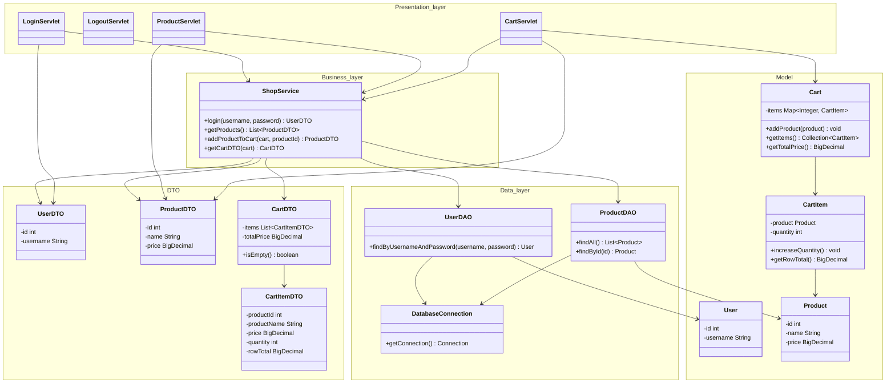

# Klassdiagram

## Lager

Presentation layer består av JSP-filer och servlets. Det lagret tar emot HTTP requests, använder `HttpSession` och arbetar med DTO-objekt för data som skickas mellan presentation och business layer.

Business layer består av `ShopService`. Det lagret innehåller applikationslogik för login, produktlista och kundvagn. `ShopService` använder modellobjekt internt och omvandlar dem till DTO-objekt innan data skickas vidare till presentation layer.

Data layer består av `UserDAO`, `ProductDAO` och `DatabaseConnection`. Det lagret använder JDBC och PostgreSQL och arbetar med modellklasserna `User` och `Product`.

DTO-klasserna `UserDTO`, `ProductDTO`, `CartDTO` och `CartItemDTO` används för att transportera data mellan business layer och presentation layer utan att exponera de interna modellobjekten direkt.